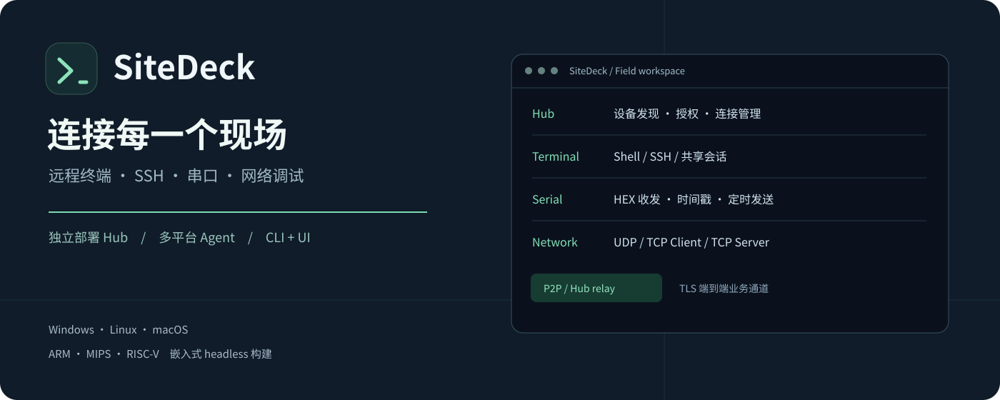
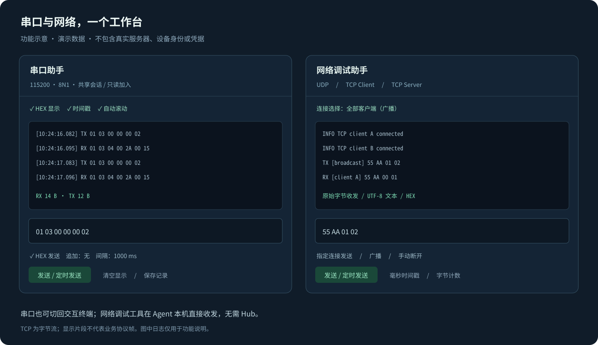
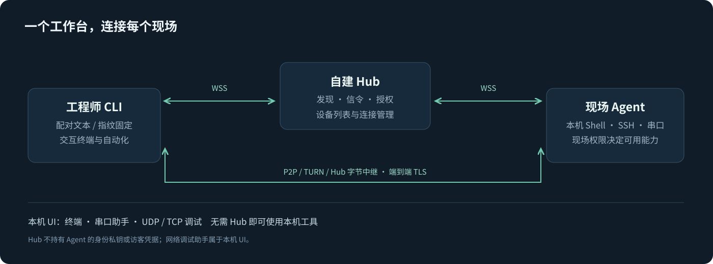

# SiteDeck



**SiteDeck（现场工作台）**是一款可独立部署的远程终端与现场调试工具。用一套 Hub、Agent 和 CLI，连接现场主机、串口与嵌入式设备；也可以只运行本机图形界面进行调试。

[快速体验](#快速体验) · [功能展示](#功能展示) · [编译](#编译) · [部署说明](docs/easy-deployment.md) · [协议](docs/protocol.md) · [验证范围](docs/status.md)

## 功能一览

| 能力 | 可以做什么 |
| --- | --- |
| Hub 管理 | 在线设备列表、设备改名、访问授权、连接查看与断开 |
| 终端与 SSH | 主机命令、交互 Shell、共享会话、只读加入、输出下载 |
| 串口助手 | 参数配置、HEX / 文本收发、毫秒时间戳、计数与定时发送 |
| 网络调试 | UDP、TCP Client、TCP Server、指定客户端发送与广播 |
| 多平台 | Windows、Linux、macOS；ARM、MIPS、RISC-V 交叉编译 |
| CLI 与 UI | JSON 自动化接口、文字配对、Windows 窗口与 Linux 浏览器界面 |

## 功能展示



*以上为功能示意图，使用演示数据，不是实际硬件或生产环境截图。所有图片都不包含真实服务器、设备身份或访问凭据。*

## 连接架构



Hub 负责发现、信令、授权与中继协调。终端、SSH 和串口操作由现场 Agent 执行，业务通道使用端到端 TLS。P2P / TURN 的可用性取决于现场网络，已验证与未验证范围见[功能状态](docs/status.md)。

## 快速体验

在已安装 Go 1.22+ 的 Ubuntu / Linux 上：

```sh
make build
./bin/site-agent ui
```

浏览器会打开本机界面。仅使用本机工具时，在「连接设置」关闭远程接入，按需启用终端或串口能力并启动服务；「网络调试」可直接使用，无需 Hub。

Windows 使用匹配 CPU 架构的 `site-agent-ui.exe`；远程部署与多设备连接见下方说明。

## SiteDeck 0.5.1

项目统一使用 **SiteDeck** 品牌：源码目录 `sitedeck/`，运行目录 `sitedeck-dis/`。
命令仍为 `site-hub`、`site-agent`、`site-agent-ui` 和 `site-cli`，现有脚本与文字配对格式继续兼容。
0.5 系列支持串口 HEX 收发、毫秒时间戳及 UDP/TCP 网络调试，Windows 程序内嵌图标。
升级和旧身份目录兼容说明见 [改名与升级](docs/renaming.md)。

## 简化部署与文字配对

0.4.0 支持程序旁 `site-agent.json` 自动加载；没有配置时手动填写并保存。
无界面设备不必导出文件：运行 `site-agent pair --plain` 获取配对文本，在本机 `site-cli pair` 粘贴即可。
设备身份独立生成，不随预配置文件复制。详见 [简化部署说明](docs/easy-deployment.md)。

## Windows 窗口界面与 CLI

0.3.0 新增 Agent 本机界面：Windows 双击 `site-agent-ui.exe` 或无参数的 `site-agent.exe` 打开窗口；
`site-agent.exe run/init/info/rotate` 保留命令行行为。界面支持本机终端、SSH、串口标签页、现场权限、
Hub 设置、配对导出和秘钥续期。可关闭远程接入使用本机模式。

普通 Windows 使用运行目录 `../sitedeck-dis/platforms/windows-amd64/`；ARM64 使用对应目录。
界面默认端口 `127.0.0.1:48767`，使用当前用户的持久数据目录。窗口需要 WebView2 Runtime，
失败时提示并尝试浏览器。详见 [Agent 界面使用说明](docs/agent-ui.md)。


## 编译

需要 Go 1.22 或更高版本。运行部署后的二进制不需要 Node.js、REA 或目标平台 C 编译器。

```sh
make build
make test
python3 scripts/smoke.py
```

全平台构建：

```sh
python3 scripts/build.py
```

产物位于 `bin/<平台>/`，每个平台分别有 Hub、Agent、CLI；哈希清单为 `bin/manifest.json`。默认目标：

| 目录 | 目标 |
| --- | --- |
| `linux-amd64` | Linux x86-64 |
| `linux-arm64` | Linux AArch64，包括 RK3568 的 64 位系统 |
| `linux-arm-v7` | Linux ARMv7 |
| `linux-mipsle` | Linux MIPS 小端，soft-float |
| `linux-riscv64` | Linux RISC-V 64 位 |
| `windows-amd64` / `windows-arm64` | Windows x64 / ARM64 |
| `darwin-amd64` / `darwin-arm64` | macOS Intel / Apple Silicon |

上述 9 组、29 个程序（含 2 个 Windows 窗口入口）已交叉编译通过；实际运行验证目前在 Linux amd64。交叉编译成功不代表已经在对应设备上验证驱动、串口权限、ConPTY 或网络条件。

也可以只编某一现场端：

```sh
python3 scripts/build.py --targets linux/arm64 --roles agent
```

构建脚本设置 `CGO_ENABLED=0`；Linux 不依赖目标系统的 glibc/uClibc 版本。仍需实机确认内核、CPU 指令集和设备驱动满足要求。

## 本机部署目录

源码位于 `sitedeck/`，实际运行目录为相邻的 **`sitedeck-dis/`**。更新部署程序：

```sh
make deploy
cd ../sitedeck-dis
./start-hub.sh
./status-hub.sh
```

停止使用 `./stop-hub.sh`。这些 Linux 辅助脚本始终切换到部署目录，避免把运行配置误写进源码目录。辅助脚本不是开机自启服务。

部署目录的 `bin/` 保存本机 Hub、Agent 和 CLI，`.local/` 保存实际使用的配置、管理密钥、授权状态及日志。更新程序不会覆盖已有部署配置；更新正在运行的 Hub 后，需要在部署目录停止并重新启动。

首次从源码目录迁移配置时，先停止旧 Hub，再执行 `python3 scripts/deploy.py --migrate-state .local`。源配置保留为备份，不复制开发预览数据。需要同时分发其他平台程序时可添加 `--all-platforms`，产物会放入部署目录的 `platforms/`。

## 本机先跑通

本节是源码目录中的开发调试示例；常规运行使用上面的部署目录。

下面三处终端使用同一个项目工作目录。初始化命令只执行一次，已有凭据文件不会被覆盖。

```sh
./bin/site-hub init
./bin/site-agent init --hub ws://127.0.0.1:48763/ws
```

第一个终端运行 Hub：

```sh
./bin/site-hub serve --listen 127.0.0.1:48763
```

第二个终端运行 Agent；现场权限由启动者明确开启，默认不开启任何执行能力：

```sh
./bin/site-agent run --hub ws://127.0.0.1:48763/ws --allow host,ssh,serial
```

第三个终端执行：

```sh
./bin/site-cli doctor
./bin/site-cli host exec --command 'uname -a'
./bin/site-cli host exec -- /bin/echo 'arguments stay separate'
./bin/site-cli host shell
./bin/site-cli serial list
./bin/site-cli session list
```

交互终端的 `Ctrl+]` 退出当前成员；最后一个成员退出时关闭该 shell。`--json` 禁用交互并返回会话 ID，可以由自动化调用后续 RPC。会话只能来自本 Agent 管理的 shell/SSH，不能直接接管 PuTTY 等外部程序。

普通命令默认输出 JSON。远程命令非零退出时保留 `exitCode`，CLI 返回 1；参数错误返回 2；直接建连或认证失败返回 3。后续 RPC/daemon 业务错误返回 1，并提供结构化 `error.code`。

## Hub Web 管理

默认监听 `127.0.0.1:48763`，管理入口为 `http://127.0.0.1:48763/admin/`，WebSocket 入口为 `ws://127.0.0.1:48763/ws`。管理页与 WebSocket 使用同一个监听端口。页面已嵌入二进制，无需另装 Web 服务或 Node.js。

运行 `site-hub init` 会创建或保留以下文件，重复执行不会轮换已有密钥或清除记录：

| 文件 | 用途 |
| --- | --- |
| `.local/hub.key` | 现场 Agent 注册凭据 |
| `.local/hub-admin.key` | 浏览器管理登录密钥，与注册凭据不同 |
| `.local/hub-state.json` | 设备名称、访问策略、授权哈希及签名身份 |

在登录页输入 `hub-admin.key` 的内容，或直接选择该密钥文件。管理会话使用 HttpOnly/SameSite Cookie，修改请求需要 CSRF 验证；管理密钥不会保存到浏览器 localStorage。

管理页包含：

- **设备列表**：在线/离线状态、系统与 CPU 架构、Agent 版本、现场已开启的能力和连接数；支持搜索、状态筛选、修改名称。名称保存在 Hub，Agent 重连或 Hub 重启不会覆盖它。
- **访问授权**：为指定设备签发主机/SSH/串口权限，设置 30 天以内的有效期，下载一次性授权文件；可以撤销授权。授权密钥只提供一次，Hub 只保存其哈希。
- **连接管理**：显示实际 P2P/TURN/Hub 中继路径、认证状态、中继字节和建立时间；可主动断开通道，包含 P2P 通道。

创建授权时默认勾选“同时切换为仅授权访问”，会关闭该设备仅凭配对文件的访问路径，并断开其现有配对通道。这样客户端不能通过省略授权文件绕过权限限制。若明确取消该选项，将保留设备现有接入策略；如果仍允许配对访问，则配对文件持有人可以不使用授权文件。

使用下载的授权文件：

```sh
./site-cli --profile /private/pair.json \
  --access-file /private/hub-access-GRANT_ID.json doctor
```

配对文件证明持有现场秘钥并固定 Agent 身份；授权文件决定 Hub 允许访问哪台设备、哪些能力，以及何时到期。最终可用权限是“Hub 授权”和“现场 Agent 能力开关”的交集；有效连接时间也同时受现场访客凭据有效期约束，Hub 授权不会延长现场授权。

daemon 需要在启动时指定授权文件，运行中不能通过另一次 CLI 调用更换同一通道的授权：

```sh
./site-cli --profile /private/pair.json \
  --access-file /private/hub-access-GRANT_ID.json \
  daemon serve --output /private/daemon.json
```

单独断开一个连接不会撤销其凭据，daemon 可能自动重连；撤销授权、授权到期或阻止设备访问则会关闭受影响的通道并拒绝再次连接。设备“访问策略”还可以切换配对/仅授权模式，以及暂时阻止所有远程访问。

受限授权要求现场 Agent 支持 v0.2 的授权协议；旧 Agent 不能使用该功能，Hub 会明确拒绝而不会降级成不受限访问。当前管理采用管理员密钥和凭据级授权，不依赖 OIDC，也没有多管理员账号体系。

更换端口时同时调整 Agent、配对文件及公网隧道的目标地址，例如：

```sh
./site-hub serve --listen 127.0.0.1:48769
./site-agent run --hub ws://127.0.0.1:48769/ws --allow host,ssh,serial
```

从旧版升级后，已有配对文件中的 `hub` 地址不会自动重写。默认端口已经从旧值改为 `48763`，需要同步修改旧配置或通过 CLI 的 `--hub` 覆盖。部署反向代理/公网隧道时保留请求 Host，以便后台执行同源验证。

## 分开部署

Hub 主机保存注册凭据和自己的 HTTPS 证书。例如：

```sh
./site-hub init --registration-file /private/hub.key
./site-hub serve --listen 0.0.0.0:48763 \
  --registration-file /private/hub.key \
  --tls-cert /private/fullchain.pem --tls-key /private/tls.key
```

将注册凭据安全地提供给现场 Agent。它只允许向 Hub 注册，不是主机执行的访问秘钥。当前注册凭据是部署级共享凭据，尚未实现每设备注册账号。

现场电脑初始化并启动：

```sh
./site-agent init --state /private/agent.json \
  --hub wss://hub.example.invalid:48763/ws --pair-file /private/pair.json
./site-agent run --state /private/agent.json \
  --registration-file /private/hub.key \
  --hub wss://hub.example.invalid:48763/ws --allow ssh,serial
```

工程师只需收到 `pair.json`，不需要现场 Agent 的私钥文件：

```sh
./site-cli --profile /private/pair.json doctor
```

`example.invalid` 是占位域名，使用时替换为自己部署的域名。远程 Hub 必须使用系统信任的 WSS 证书；明文 WS 只允许回环 IP。Agent 的端到端证书则通过配对文件中的 SHA-256 指纹固定，不依赖 Hub 代为证明。

状态、配对、注册和 daemon 文件均包含敏感信息；生成时使用受限文件权限。Windows 部署还需将保存目录的 ACL 限制到运行账户。

## P2P、TURN 与中继

```sh
./site-cli --profile pair.json --transport p2p doctor
./site-cli --profile pair.json --transport relay doctor
./site-cli --profile pair.json --transport auto doctor
```

`auto` 先使用不含 TURN 的 ICE 候选，失败后用完整 ICE 配置重新协商，最后使用 Hub 字节中继。每轮 ICE 默认 8 秒，可通过 `--ice-timeout 15s` 调整。未提供 ICE 配置时可以局域网直连或使用 Hub 中继，跨公网 NAT 的直连需要按现场网络配置 STUN。

`--ice-file` 接受 Pion 格式 JSON 数组，例如：

```json
[
  {"urls": ["stun:stun.example.invalid:3478"]},
  {"urls": ["turn:turn.example.invalid:3478"], "username": "REPLACE_USER", "credential": "REPLACE_SECRET"}
]
```

Agent 和 CLI 分别通过 `--ice-file /private/ice.json` 读取。TURN 服务和凭据由部署方提供，Hub 当前不签发 TURN 临时凭据。

`doctor.connection` 返回实际的 `transport`、候选类型和频道 ID。自动回落原因在本机 `daemon status` 或连接对象的诊断中；尚未通过协议把客户端回落原因同步给 Agent 的 `doctor`。TURN 接入代码已编译，但尚未连接真实 TURN 服务实测。中继和 DataChannel 上都运行 Agent 与 CLI 直接终止的 TLS 1.3，Hub 不持有 Agent 的身份私钥或访客秘钥。

## 连接复用

daemon 在前台运行，可放入自己的进程管理器；返回 `ready:true` 后才创建可用的描述文件：

```sh
./site-cli --profile pair.json daemon serve --output /private/daemon.json
```

后续进程复用同一个远程连接：

```sh
./site-cli --daemon-file /private/daemon.json doctor
./site-cli --daemon-file /private/daemon.json host exec --command hostname
./site-cli --daemon-file /private/daemon.json daemon status
./site-cli --daemon-file /private/daemon.json daemon stop
```

本机 IPC 只绑定回环地址并校验描述文件中的随机凭据。daemon 重连不会重放命令或恢复旧会话；失联时尚未收到响应的写操作需要自行核对结果。正常退出删除描述文件，崩溃留下的文件需先确认原进程已停止，再手动移除。

自动化需要通过多次 CLI 调用操作同一 shell 时，在 daemon 模式下指定相同的 `--client-id task-A`，再依次调用 `session attach`、`session write/read` 和 `session detach`。未指定时，每次 CLI 调用使用独立成员 ID，适合彼此独立的交互终端；一次性 `session attach --json` 的成员会保留到显式 detach 或 daemon 通道关闭。

## SSH、串口与通用 RPC

所有 SSH/串口操作在现场 Agent 上完成。更多参数和返回值见 [协议说明](docs/protocol.md)。

```sh
./site-cli rpc ssh.hostkey.scan --input scan.json
./site-cli ssh exec --input /private/ssh-request.json
./site-cli ssh shell --input /private/ssh-request.json
./site-cli serial connect --port /dev/ttyUSB0 --baud 115200
./site-cli serial write --id SESSION_ID --text 'help\r\n'
./site-cli serial read --id SESSION_ID --source rx
./site-cli serial watch --id SESSION_ID
./site-cli serial exec --input serial-command.json
./site-cli serial disconnect --id SESSION_ID
```

Shell 引号中的 `\r\n` 不会被 CLI 再解释。需要实际回车换行时使用 JSON `--input` 的 `text` 字段，或通过受保护 stdin 传入 JSON；不要依赖 shell 转义差异。

SSH 请求须包含 `host`、`user`、可信的 `fingerprint`，以及 `password` 或 `privateKey`。扫描只发现指纹，首次使用仍需可信渠道核对。私钥和密码会通过端到端通道送到 Agent 用于现场 SSH 认证，不会传给信令 Hub。示例结构见 `examples/`；真实凭据不要写进仓库或命令参数。

串口 `data` 为 Base64 原始字节；`text` 为 UTF-8。RX/TX 共用带代次的游标时间线，`source` 可选 `all`、`rx`、`tx`。`serial.wait` 无游标时只等新 RX；`serial.exec` 在发送前取得 RX 起点，提示符匹配不等于设备命令执行成功。正则采用 Go/RE2 语义，不支持 JavaScript 的 lookaround 或反向引用。

主机/SSH 输出各最多保留 1 MiB；超过 16 KiB 的 JSON 结果会返回下载引用，CLI 在同一连接上自动分块下载、核对 SHA-256，再返回本机 `artifactPath`。`captureTruncated` 表示采集上限导致原始输出被截断。下载缓存仅保存在 Agent 内存，重启或达到 16 MiB 总量后可能清除。

## 现场撤销

访客授权默认有效 24 小时；初始化或轮换时可指定 `--guest-ttl 8h`。到期时退出 Agent、断开所有活动通道并关闭所管理的现场资源。轮换令牌后，在运行的 Agent 会检测到状态变化，撤销旧通道并重新注册：

```sh
./site-agent rotate --state /private/agent.json --guest-ttl 8h
./site-agent init --state /private/agent.json \
  --hub wss://hub.example.invalid:48763/ws --pair-file /private/new-pair.json
```

将新配对文件发给工程师，并重启使用旧凭据的本机 daemon。如果 Agent 因到期已退出，需要现场人员重新启动。重新导出配对文件不会延长已有授权。
